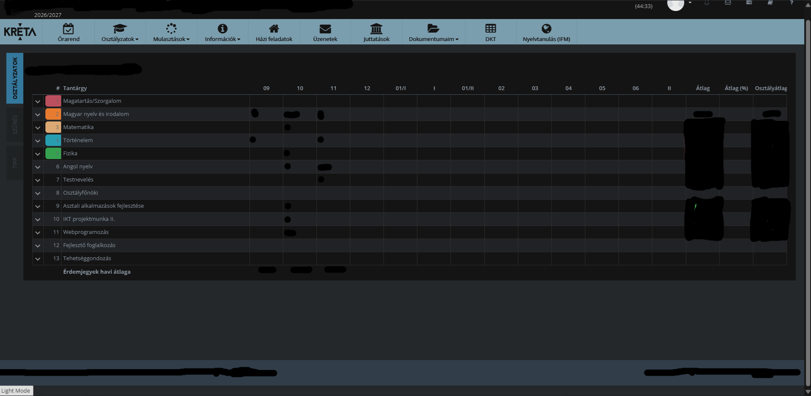
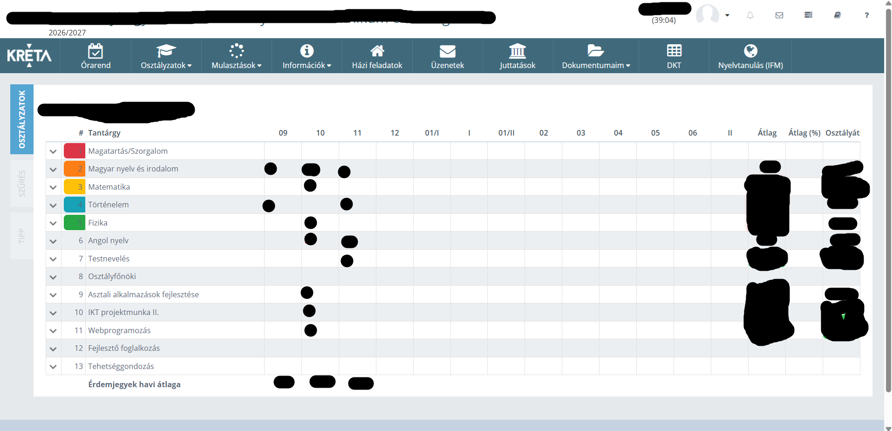

# Kréta & Neptun Beautifier 🌙

A lightweight Tampermonkey userscript designed to modernize the Hungarian e-Kréta (and Neptun) student portals with a persistent Dark Mode and instant visual feedback for grades and subject averages.

*Disclosure: Built with AI assistance for CSS invert filtering and readme translate.*

## ✨ Features
- **Smart Dark Mode Toggle:** Adds a floating button in the bottom-right corner that inverts page colors while keeping images and grade badges natural. Saves your preference in `localStorage`.
- **Color-Coded Grades:** Automatically highlights individual grades (1–5) with distinct, easy-to-read color badges.
- **Low Average Alerts:** Detects subject averages (e.g., `2,75`) and highlights averages below `3.0` in red so you immediately know which subjects need focus.
- **Dynamic SPA Support:** Uses a `MutationObserver` to apply styles seamlessly as you navigate between tabs without reloading the page.

## 🚀 Installation
1. Install the [Tampermonkey](https://www.tampermonkey.net/) browser extension (make sure **Developer Mode** is enabled in your browser's extension settings).
2. Click the direct install link below:
   👉 **[Install Script (Raw)](https://github.com/mpeti1234/kreta-neptun-beautifier/raw/main/kreta-beautifier.user.js)**
3. Click **Install** in the Tampermonkey tab that opens, then refresh your e-Kréta page.

## 📸 Preview

*I couldn't test it with Neptun because I only have access to Kréta.